# 🏛️ LUNARA SILVER — TÀI LIỆU TOÀN DIỆN VỀ KIẾN TRÚC, NGHIỆP VỤ & HỆ THỐNG
## NỀN TẢNG THƯƠNG MẠI ĐIỆN TỬ TRANG SỨC BẠC CAO CẤP (LARAVEL 12 & SERVICE LAYER)

> **Mục đích tài liệu:** Đây là tài liệu kỹ thuật tổng thể (Master Architectural Document) của dự án **Lunara Silver**, mô tả chi tiết 100% kiến trúc phần mềm, mô hình dữ liệu (ERD), nguyên tắc bản chụp bất biến, động cơ tồn kho ảo, cổng thanh toán VNPay, hệ thống khuyến mãi, bảo mật, quy trình kiểm thử và 12 sơ đồ tuần tự nghiệp vụ cốt lõi từ Phase 1 đến Phase 21.

---

## 📑 MỤC LỤC TỔNG QUAN

1. [Tổng quan Hệ thống & Định hướng Thương hiệu](#1-tổng-quan-hệ-thống--định-hướng-thương-hiệu)
2. [Mô hình Kiến trúc Phân tầng (Layered Architecture)](#2-mô-hình-kiến-trúc-phân-tầng-layered-architecture)
3. [Phân hệ Người dùng & Ma trận Phân quyền Tác nhân (Actors)](#3-phân-hệ-người-dùng--ma-trận-phân-quyền-tác-nhân-actors)
4. [Sơ đồ Use Case Toàn hệ thống](#4-sơ-đồ-use-case-toàn-hệ-thống)
5. [Sơ đồ Thực thể Quan hệ Toàn diện (Entity Relationship Diagram - ERD)](#5-sơ-đồ-thực-thể-quan-hệ-toàn-diện-entity-relationship-diagram---erd)
6. [Kiến trúc Dữ liệu & Nguyên tắc Bản chụp Bất biến (Immutable Snapshot)](#6-kiến-trúc-dữ-liệu--nguyên-tắc-bản-chụp-bất-biến-immutable-snapshot)
7. [Động cơ Tồn kho Ảo Động Độc quyền (Dynamic Virtual Inventory Engine)](#7-động-cơ-tồn-kho-ảo-động-độc-quyền-dynamic-virtual-inventory-engine)
8. [Tích hợp Cổng Thanh toán VNPay Sandbox V2 Toàn diện](#8-tích-hợp-cổng-thanh-toán-vnpay-sandbox-v2-toàn-diện)
9. [Động cơ Khuyến mãi & Giảm giá Đa tầng (Coupon Engine)](#9-động-cơ-khuyến-mãi--giảm-giá-đa-tầng-coupon-engine)
10. [Hệ thống Đánh giá Xác thực Mua hàng (Verified Buyer Reviews)](#10-hệ-thống-đánh-giá-xác-thực-mua-hàng-verified-buyer-reviews)
11. [Trung tâm Chăm sóc Khách hàng Concierge & Live Chat Thời gian thực](#11-trung-tâm-chăm-sóc-khách-hàng-concierge--live-chat-thời-gian-thực)
12. [Trung tâm Điều hành Admin Customer 360 & Báo cáo Doanh thu Thuần](#12-trung-tâm-điều-hành-admin-customer-360--báo-cáo-doanh-thu-thuần)
13. [Hệ thống Quản trị Đa phương tiện Cloudinary & Fallback Đa tầng](#13-hệ-thống-quản-trị-đa-phương-tiện-cloudinary--fallback-đa-tầng)
14. [Tự động hóa SEO, Schema Microdata & Bộ điều hướng Chống Loop](#14-tự-động-hóa-seo-schema-microdata--bộ-điều-hướng-chống-loop)
15. [Phân hệ Tin tức Blog & Thanh tìm kiếm Phím tắt Command Palette (Ctrl+K)](#15-phân-hệ-tin-tức-blog--thanh-tìm-kiếm-phím-tắt-command-palette-ctrlk)
16. [Đặc tả & Sơ đồ Tuần tự 12 Luồng Nghiệp vụ Then chốt (Sequence Diagrams)](#16-đặc-tả--sơ-đồ-tuần-tự-12-luồng-nghiệp-vụ-then-chốt-sequence-diagrams)
17. [Bản đồ Cấu trúc Mã nguồn & Lớp Dịch vụ (Directory Layout & Service Layer)](#17-bản-đồ-cấu-trúc-mã-nguồn--lớp-dịch-vụ-directory-layout--service-layer)

---

## 1. TỔNG QUAN HỆ THỐNG & ĐỊNH HƯỚNG THƯƠNG HIỆU

### 1.1 Bối Cảnh Nghiệp Vụ
**Lunara Silver** là nền tảng thương mại điện tử chuyên biệt dành cho thương hiệu trang sức bạc 925 và đá quý cao cấp. Danh mục sản phẩm được chuẩn hóa nghiêm ngặt từ dữ liệu thực tế gồm **45 sản phẩm** chia thành 3 phân nhóm chiến lược:
* **30 sản phẩm bán lẻ đơn chiếc (`single`)**: 
  - 10 dây chuyền bạc tinh xảo (`LNS-DC001` đến `LNS-DC010`)
  - 10 nhẫn bạc đính đá cao cấp (`LNS-NH001` đến `LNS-NH010`)
  - 10 lắc tay và vòng tay bạc phong cách (`LNS-VT001` đến `LNS-VT010`)
* **10 bộ sưu tập / Set (`collection`)**: Các combo trang sức được phối hợp đồng bộ giữa nhẫn, dây chuyền và vòng tay (`LNS-SET001` đến `LNS-SET010`).
* **5 set quà tặng cao cấp (`gift`)**: Hộp quà tặng sang trọng tích hợp trang sức, thiệp viết tay và phụ kiện cao cấp (`LNS-QT001` đến `LNS-QT005`).

### 1.2 Triết Lý Thiết Kế: Celestial Luxury Minimalism
Giao diện người dùng được thiết kế dựa trên chủ nghĩa tối giản sang trọng lấy cảm hứng từ vầng trăng và bầu trời đêm:
* **Bảng màu chủ đạo (Color Palette)**:
  * `Midnight Navy` (`#1B2A4A`, `#0F172A`): Màu bầu trời đêm tĩnh lặng, làm nền tảng cho Header, Footer, Hero slider và các thành phần điểm nhấn.
  * `Silver Sparkle` (`#C0C0C0`, `#E2E8F0`): Màu ánh kim bạc 925, tạo viền và hiệu ứng hover tinh xảo.
  * `Celestial Gold` (`#D4AF37`, `#F59E0B`): Ánh vàng kim nhấn nhá các nhãn Sale, sao đánh giá và nút hành động đặc biệt.
  * `Pure Silk Ivory` (`#F8FAFC`, `#FFFFFF`): Nền trắng ngà thanh lịch, tôn vinh hình ảnh trang sức chân thực nhất.
* **Hệ thống Font chữ (Typography)**:
  * Font tiêu đề: `Playfair Display` (Serif cổ điển, thanh thoát, sang trọng).
  * Font nội dung: `Inter` (Sans-serif hiện đại, độ dễ đọc hoàn hảo trên mọi kích thước màn hình).

---

## 2. MÔ HÌNH KIẾN TRÚC PHÂN TẦNG (LAYERED ARCHITECTURE)

Hệ thống tuân thủ chặt chẽ nguyên lý **Separation of Concerns (SoC)** và tư duy **Thin Controllers - Rich Domain Services**:

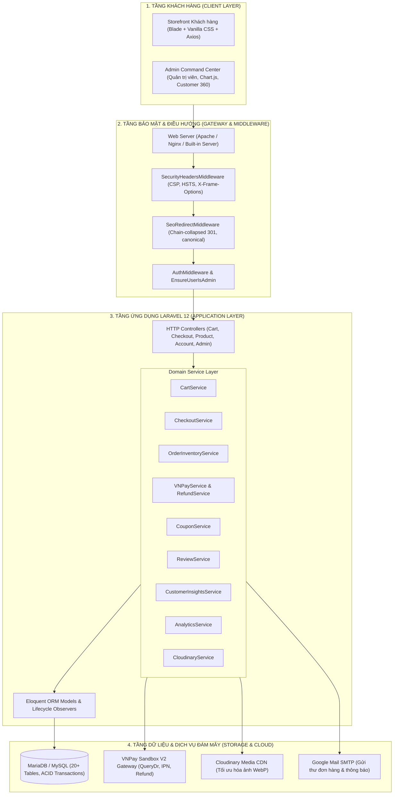

---

## 3. PHÂN HỆ NGƯỜI DÙNG & MA TRẬN PHÂN QUYỀN TÁC NHÂN (ACTORS)

| Tác nhân (Actor) | Bản chất | Vai trò & Đặc quyền trong hệ thống |
| :--- | :--- | :--- |
| **Khách vãng lai (Guest)** | Người dùng chưa đăng nhập | Duyệt catalog, tìm kiếm, lọc sản phẩm, thêm giỏ hàng (lưu session), nhập mã coupon, đặt hàng COD/VNPay, khởi tạo live chat Concierge với token khách. |
| **Khách hàng đã đăng ký (Customer)** | Tài khoản có `role = 'user'` | Toàn bộ quyền của Guest, đồng thời: Lưu sổ địa chỉ nhiều địa chỉ, xem lịch sử đơn hàng, thanh toán lại đơn pending, gửi đánh giá có xác thực mua hàng (Verified Buyer), quản lý hồ sơ cá nhân. |
| **Quản trị viên (Admin)** | Tài khoản có `role = 'admin'` | Toàn quyền kiểm soát hệ thống: Xem Dashboard doanh thu thuần (Net Revenue), quản lý 45 sản phẩm (đơn/combo/quà tặng), upload ảnh Cloudinary, kiểm duyệt đánh giá, quản trị máy trạng thái đơn hàng & hoàn tiền VNPay, quản trị mã coupon, tra cứu Customer 360. |

---

## 4. SƠ ĐỒ USE CASE TOÀN HỆ THỐNG

### 4.1 Use Case Khách Hàng (Storefront & Account)

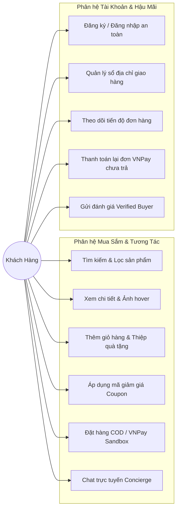

### 4.2 Use Case Quản Trị Viên (Admin Management)

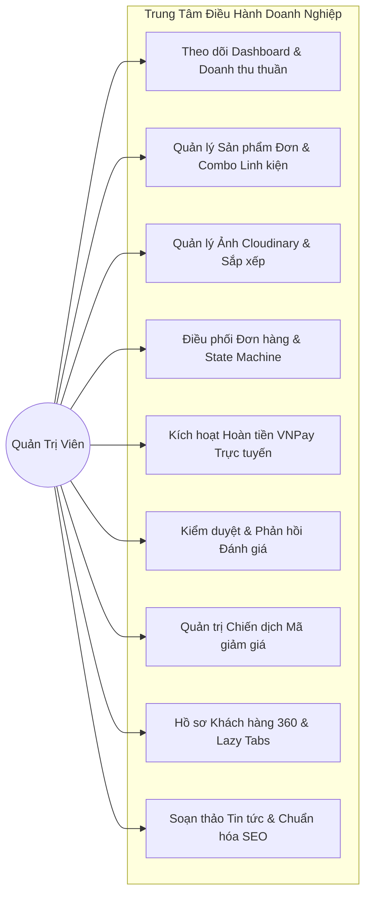

---

## 5. SƠ ĐỒ THỰC THỂ QUAN HỆ TOÀN DIỆN (ENTITY RELATIONSHIP DIAGRAM - ERD)

```mermaid
erDiagram
    USERS ||--o{ ORDERS : places
    USERS ||--o{ REVIEWS : writes
    USERS ||--o{ ADDRESSES : owns
    USERS ||--o{ CHAT_SESSIONS : initiates
    USERS ||--o{ COUPON_USAGES : uses

    CATEGORIES ||--o{ PRODUCTS : categorizes
    
    PRODUCTS ||--o{ PRODUCT_IMAGES : contains
    PRODUCTS ||--o{ BUNDLE_ITEMS : "is parent of"
    PRODUCTS ||--o{ BUNDLE_ITEMS : "is component of"
    PRODUCTS ||--o{ ORDER_ITEMS : snapshotted_into
    PRODUCTS ||--o{ REVIEWS : receives

    COUPONS ||--o{ COUPON_USAGES : tracks
    COUPONS ||--o{ ORDERS : applied_to

    ORDERS ||--|{ ORDER_ITEMS : includes
    ORDERS ||--o{ PAYMENTS : generates
    ORDERS ||--o{ ORDER_STATUS_HISTORIES : tracks_status

    ORDER_ITEMS ||--o{ ORDER_ITEM_COMPONENTS : decomposes_into
    ORDER_ITEMS ||--o{ REVIEWS : enables_verified

    CHAT_SESSIONS ||--|{ CHAT_MESSAGES : logs

    USERS {
        bigint id PK
        string name
        string email UK
        string password
        enum role "user, admin"
        timestamp email_verified_at
        timestamps created_at_updated_at
    }

    CATEGORIES {
        bigint id PK
        string name
        string slug UK
        text description
        boolean is_active
        integer sort_order
    }

    PRODUCTS {
        bigint id PK
        bigint category_id FK
        string sku UK
        string name
        string slug UK
        enum product_type "single, collection, gift"
        decimal regular_price
        decimal sale_price
        integer stock_quantity
        enum stock_status "in_stock, out_of_stock"
        boolean is_active
        boolean is_featured
        text description
    }

    PRODUCT_IMAGES {
        bigint id PK
        bigint product_id FK
        string image_url
        string public_id
        enum role "primary, hover, gallery"
        integer sort_order
    }

    BUNDLE_ITEMS {
        bigint id PK
        bigint bundle_id FK "Parent combo product"
        bigint component_id FK "Component single product"
        integer quantity "Component quantity"
    }

    COUPONS {
        bigint id PK
        string code UK
        enum discount_type "percentage, fixed"
        decimal discount_value
        decimal min_order_amount
        decimal max_discount_amount
        integer max_uses
        integer max_uses_per_user
        boolean is_first_order_only
        timestamp starts_at
        timestamp expires_at
        boolean is_active
    }

    ORDERS {
        bigint id PK
        string order_code UK
        bigint user_id FK "Nullable for guest"
        bigint coupon_id FK "Nullable"
        decimal subtotal
        decimal coupon_discount_amount
        decimal shipping_fee
        decimal total_amount
        enum payment_method "cod, vnpay"
        enum payment_status "pending, paid, failed, refunded"
        enum order_status "pending, processing, shipping, completed, cancelled"
        json shipping_address "Immutable snapshot"
        text customer_note
        text cancellation_reason
        timestamps created_at_updated_at
    }

    ORDER_ITEMS {
        bigint id PK
        bigint order_id FK
        bigint product_id FK "SET NULL on delete"
        string snapshot_product_name
        string snapshot_sku
        decimal unit_price
        integer quantity
        decimal subtotal
        text gift_note "Personalized message"
    }

    ORDER_ITEM_COMPONENTS {
        bigint id PK
        bigint order_item_id FK
        bigint component_id FK "SET NULL on delete"
        string snapshot_component_sku
        string snapshot_component_name
        integer quantity_per_bundle
        integer total_component_quantity
    }

    PAYMENTS {
        bigint id PK
        bigint order_id FK
        string transaction_code UK
        decimal amount
        enum gateway "vnpay, cod"
        enum status "pending, success, failed, refunded"
        string vnp_bank_code
        string vnp_card_type
        json raw_payload
        timestamps created_at_updated_at
    }

    REVIEWS {
        bigint id PK
        bigint product_id FK
        bigint user_id FK
        bigint order_item_id FK UK
        integer rating "1 to 5 stars"
        string title
        text content
        boolean is_verified_buyer "True"
        enum status "pending, approved, rejected"
        text admin_reply
        timestamp admin_replied_at
    }

    CHAT_SESSIONS {
        bigint id PK
        string session_token UK
        bigint user_id FK "Nullable"
        string customer_name
        string customer_phone
        enum status "active, closed"
    }

    CHAT_MESSAGES {
        bigint id PK
        bigint chat_session_id FK
        enum sender_type "customer, admin, system"
        text message
        boolean is_read
        timestamp created_at
    }
```

---

## 6. KIẾN TRÚC DỮ LIỆU & NGUYÊN TẮC BẢN CHỤP BẤT BIẾN (IMMUTABLE SNAPSHOT)

Trong các hệ thống bán hàng kém hoàn thiện, việc lưu đơn hàng thường chỉ dùng khóa ngoại trỏ về sản phẩm và sổ địa chỉ. Khi Admin đổi tên sản phẩm, tăng giá hoặc xóa sản phẩm, lịch sử các hóa đơn cũ sẽ bị sai lệch hoàn toàn, thậm chí làm crash trang hóa đơn!

**Giải pháp độc quyền của Lunara Silver:**
1. **Bản chụp địa chỉ giao hàng (`orders.shipping_address`)**: Khi thanh toán, toàn bộ họ tên, điện thoại, địa chỉ cụ thể, tỉnh/thành được serialize và lưu bất biến dưới dạng JSON. Dù sau này khách hàng có đổi hoặc xóa địa chỉ trong sổ địa chỉ, đơn hàng cũ vẫn giữ nguyên vẹn địa chỉ giao hàng lịch sử.
2. **Bản chụp sản phẩm trong đơn (`order_items`)**: Lưu trữ bản sao độc lập của `snapshot_product_name`, `snapshot_sku`, `unit_price`, `subtotal`. Khóa ngoại `product_id` được đặt `ON DELETE SET NULL`. Nhờ vậy, ngay cả khi sản phẩm gốc bị xóa khỏi catalog, trang chi tiết đơn hàng vẫn hiển thị tên, mã SKU và giá chính xác như tại thời điểm giao dịch.
3. **Bản chụp linh kiện cấu thành combo (`order_item_components`)**: Khi khách hàng mua một Set hoặc Hộp quà (`collection`/`gift`), hệ thống chụp lại chi tiết từng SKU linh kiện đơn và số lượng tương ứng. Nhờ đó, nếu sau này Admin có thay đổi cấu trúc của Set, việc hoàn kho khi hủy đơn vẫn được thực hiện chính xác 100% theo đúng linh kiện thực tế tại thời điểm mua.
4. **Bản chụp chiết khấu khuyến mãi (`orders.coupon_discount_amount`)**: Lưu chính xác số tiền giảm giá được trừ vào thời điểm áp mã, không tính toán lại động để tránh sai lệch kế toán khi quy tắc coupon thay đổi.

---

## 7. ĐỘNG CƠ TỒN KHO ẢO ĐỘNG ĐỘC QUYỀN (DYNAMIC VIRTUAL INVENTORY ENGINE)

### 7.1 Vấn Đề Nghiệp Vụ Của Combo / Set Quà Tặng
Một chiếc nhẫn bạc `LNS-NH001` vừa có thể bán lẻ cho khách A, vừa nằm trong Bộ sưu tập `LNS-SET001` bán cho khách B, lại vừa nằm trong Set quà tặng `LNS-QT002` bán cho khách C. Nếu gán số tồn kho cứng cho từng combo, số lượng trong kho sẽ bị trùng lặp và dẫn tới bán vượt quá khả năng cung ứng thực tế (Overselling).

### 7.2 Thuật Toán Tính Tồn Kho Động
Trong Lunara Silver:
* **Sản phẩm đơn lẻ (`single`)**: Tồn kho là giá trị số học thực tế lưu tại cột `products.stock_quantity`.
* **Bộ sưu tập (`collection`) và Quà tặng (`gift`)**: Cột `stock_quantity` trong cơ sở dữ liệu luôn mang tính placeholder (`0`). Số lượng khả dụng để bán ra được tính toán động theo thời gian thực dựa trên số lượng tồn nhỏ nhất của các linh kiện thành phần:

$$\text{AvailableQuantity}(\text{Bundle}) = \min_{c \in \text{Components}} \left( \left\lfloor \frac{\text{Stock}(c)}{\text{RequiredQty}(c)} \right\rfloor \right)$$

*Ví dụ thực tế:* Set quà tặng `LNS-QT001` gồm 1 Dây chuyền `DC001` (kho còn 15 chiếc) và 1 Nhẫn `NH001` (kho còn 2 chiếc).
$\Rightarrow \text{AvailableQuantity} = \min(15, 2) = 2$ set. Khi 2 chiếc nhẫn `NH001` được bán hết, Set quà tặng `LNS-QT001` tự động chuyển sang trạng thái **Hết hàng (Out of Stock)** tức thì.

### 7.3 Thuật Toán Tổng Hợp Nhu Cầu Chéo (Cross-Demand Aggregator)
Khi khách hàng đưa vào giỏ hàng vừa sản phẩm lẻ vừa sản phẩm combo có chứa linh kiện chung:
* Ví dụ: Khách chọn mua 2 chiếc nhẫn `NH001` và 1 Set `SET001` (chứa 1 nhẫn `NH001`).
* Tổng nhu cầu thực sự của linh kiện `NH001` là: $2 + (1 \times 1) = 3$ chiếc.
* Lớp `CartService` và `CheckoutService` sẽ tổng hợp toàn bộ nhu cầu theo từng SKU linh kiện trước khi kiểm tra số lượng tồn thật trong cơ sở dữ liệu.

### 7.4 Khóa Giao Dịch Chống Tranh Chấp (Pessimistic Locking & Database Transactions)
Khi khách hàng nhấn nút Đặt hàng, `CheckoutService` bao bọc toàn bộ quy trình trong một Database Transaction có cơ chế khóa:
```php
DB::transaction(function () use ($cart, $orderData) {
    // 1. Lock các dòng sản phẩm đơn trong DB (lockForUpdate)
    // 2. Thẩm tra số lượng tồn kho khả dụng
    // 3. Trừ kho sản phẩm đơn hoặc phân rã linh kiện của combo để trừ kho
    // 4. Nếu tồn kho về 0, tự động cập nhật stock_status = 'out_of_stock'
    // 5. Lưu đơn hàng và các bản chụp snapshot bất biến
});
```

---

## 8. TÍCH HỢP CỔNG THANH TOÁN VNPAY SANDBOX V2 TOÀN DIỆN

Hệ thống tích hợp cổng thanh toán trực tuyến hàng đầu Việt Nam - **VNPAY Sandbox** theo chuẩn tài liệu API V2:

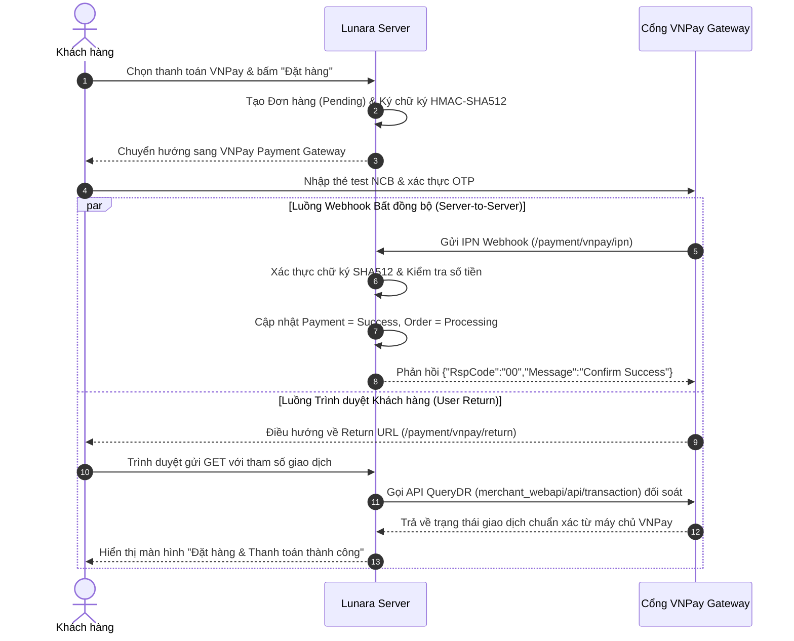

### 8.1 Thuật Toán Ký Số Bảo Mật HMAC-SHA512
Mọi tham số gửi sang VNPay (`vnp_TmnCode`, `vnp_Amount`, `vnp_TxnRef`, `vnp_OrderInfo`, `vnp_ReturnUrl`,...) được sắp xếp theo thứ tự bảng chữ cái (alphabetical sort), URL-encoded chuẩn RFC 3986 và băm bằng thuật toán **HMAC-SHA512** với khóa bí mật `VNPAY_HASH_SECRET`.

### 8.2 Chống Xử Lý Trùng Lặp Webhook (Idempotent Webhook)
Khi VNPay gửi thông báo trạng thái giao dịch về webhook IPN:
1. Xác thực chữ ký số `vnp_SecureHash`.
2. Kiểm tra xem mã giao dịch `vnp_TxnRef` có tồn tại trong hệ thống hay không.
3. Kiểm tra số tiền `vnp_Amount` có khớp với đơn hàng hay không (phòng chống tấn công can thiệp số tiền).
4. **Idempotency**: Nếu trạng thái đơn hàng đã là `paid`, hệ thống phản hồi ngay `{"RspCode":"02","Message":"Order already confirmed"}` mà không trừ lại kho hay ghi nhận trùng lặp.

### 8.3 Đối Soát Giao Dịch QueryDR Tại Return URL
Khi khách hàng quay về trang Return URL, thay vì chỉ tin tưởng vào các tham số URL truyền qua trình duyệt (vốn có thể bị giả mạo), `PaymentReconciliationService` chủ động gửi request HTTPS POST đến máy chủ API của VNPay (`merchant_webapi/api/transaction`) để truy vấn trực tiếp trạng thái thực tế của giao dịch trước khi xác nhận đơn hàng thành công.

### 8.4 Thử Lại Thanh Toán & Hoàn Tiền Tự Động (Refund API)
* **Thử lại thanh toán (Payment Retry)**: Khi thanh toán lần đầu bị lỗi hoặc khách vô tình đóng tab, đơn hàng được giữ ở trạng thái `pending`. Khách hàng có thể nhấn nút "Thử thanh toán lại" trên trang chi tiết đơn hàng để tạo phiên thanh toán mới mà không bị nhân đôi số lượng trừ kho.
* **Hoàn tiền tự động (Automated Refund)**: Khi Admin hủy đơn hàng đã thanh toán VNPay, `RefundService` tự động ký yêu cầu hoàn tiền (Transaction Type `02` - Hoàn toàn phần hoặc `03` - Hoàn một phần) gửi sang VNPay và tự động hoàn lại số lượng tồn kho cho từng linh kiện.

---

## 9. ĐỘNG CƠ KHUYẾN MÃI & GIẢM GIÁ ĐA TẦNG (COUPON ENGINE)

Được phát triển hoàn thiện tại Phase 14, hệ thống mã giảm giá hỗ trợ đầy đủ các quy tắc khuyến mãi khắt khe của doanh nghiệp thương mại điện tử:
* **Loại chiết khấu**: Giảm theo phần trăm (`percentage`, ví dụ: giảm 15%) hoặc số tiền cố định (`fixed`, ví dụ: giảm 50.000đ).
* **Trần giảm giá tối đa (`max_discount_amount`)**: Giới hạn số tiền giảm tối đa đối với coupon phần trăm (ví dụ: giảm 20% nhưng tối đa không quá 200.000đ).
* **Giá trị đơn hàng tối thiểu (`min_order_amount`)**: Chỉ áp dụng khi tổng tiền hàng đạt mức quy định.
* **Giới hạn số lượt dùng**: Giới hạn tổng số lượt toàn hệ thống (`max_uses`) và số lượt tối đa trên mỗi tài khoản người dùng (`max_uses_per_user`).
* **Coupon dành riêng cho đơn đầu tiên (`is_first_order_only`)**: Tự động kiểm tra lịch sử mua hàng của khách, từ chối áp dụng nếu khách đã từng có đơn hàng trước đó.
* **Bảo toàn coupon khi hủy đơn**: Nếu đơn hàng bị hủy khi chưa hoàn tất, hệ thống tự động giải phóng bản ghi `coupon_usages`, cho phép khách hàng sử dụng lại mã giảm giá trong lần mua tiếp theo.

---

## 10. HỆ THỐNG ĐÁNH GIÁ XÁC THỰC MUA HÀNG (VERIFIED BUYER REVIEWS)

Được triển khai tại Phase 17, hệ thống đánh giá sản phẩm bảo đảm tính trung thực tuyệt đối cho thương hiệu trang sức cao cấp:
* **Quy tắc Người mua đã xác thực (Verified Buyer Enforcement)**: Chỉ những khách hàng đã đăng nhập và sở hữu đơn hàng chứa sản phẩm đó ở trạng thái `completed` mới có quyền gửi đánh giá.
* **Ràng buộc duy nhất (Unique Constraint)**: Mỗi sản phẩm trong một đơn hàng chỉ được phép đánh giá một lần duy nhất (`order_item_id` là Unique Key).
* **Bảo vệ quyền riêng tư người dùng (Name Masking)**: Tên khách hàng hiển thị công khai trên trang sản phẩm được tự động che giấu ký tự giữa (ví dụ: `Nguyễn Văn An` $\rightarrow$ `Ng*** A.`).
* **Kiểm duyệt hai tầng & Phản hồi Admin**: Mọi đánh giá mới được đưa vào hàng đợi kiểm duyệt (`pending`). Admin có thể duyệt (`approved`), từ chối (`rejected`) hoặc gửi câu trả lời chính thức của thương hiệu (`admin_reply`).
* **Tự động cập nhật SEO Microdata**: Khi sản phẩm có đánh giá được duyệt, hệ thống tự động sinh cấu trúc JSON-LD `AggregateRating` với điểm số trung bình và số lượng review phục vụ hiển thị ngôi sao vàng trên Google Search.

---

## 11. TRUNG TÂM CHĂM SÓC KHÁCH HÀNG CONCIERGE & LIVE CHAT THỜI GIAN THỰC

Được triển khai tại Phase 20, Lunara Concierge nâng tầm trải nghiệm mua sắm trang sức trực tuyến:
* **Hỗ trợ Khách vãng lai qua Session Token**: Khách hàng chưa đăng nhập vẫn có thể bắt đầu phiên trò chuyện ngay lập tức thông qua mã định danh phiên ngẫu nhiên `session_token`.
* **Lời chào & Gợi ý câu hỏi tự động (Quick Chips)**: Cung cấp sẵn các nút tư vấn nhanh: "Tư vấn chọn size nhẫn", "Chính sách bảo hành bạc 925", "Thời gian giao hàng toàn quốc".
* **Giao diện Quản trị Chat tập trung**: Admin có thể xem toàn bộ các cuộc trò chuyện đang hoạt động, lọc theo trạng thái, trả lời tin nhắn của khách và đánh dấu hoàn tất phiên tư vấn.

---

## 12. TRUNG TÂM ĐIỀU HÀNH ADMIN CUSTOMER 360 & BÁO CÁO DOANH THU THUẦN

### 12.1 Báo Cáo Doanh Thu Thuần Chuẩn Kế Toán (Net Revenue Accounting)
Tại Dashboard Admin, hệ thống tính toán doanh thu thực tế theo công thức tài chính:

$$\text{Net Revenue} = \text{Gross Revenue} - \text{Refunded Amount} - \text{Coupon Discounts}$$

Doanh thu từ các đơn hàng bị hủy hoặc đã hoàn tiền VNPay được tự động tách riêng và khấu trừ, tránh tình trạng báo cáo doanh thu ảo.

### 12.2 Hồ Sơ Khách Hàng 360 (Customer 360 Insights)
Admin có thể xem bức tranh toàn cảnh về từng khách hàng:
* **Chỉ số giá trị vòng đời (LTV - Customer Lifetime Value)**: Tổng số tiền đã chi tiêu qua tất cả các đơn hàng hoàn tất.
* **Tần suất và giá trị trung bình đơn (AOV - Average Order Value)**.
* **Kiến trúc Tải lười bằng AJAX (Lazy Tab AJAX)**: Trang chi tiết khách hàng chia thành 4 tab chuyên sâu: *Tổng quan & RFM*, *Lịch sử Đơn hàng*, *Đánh giá Sản phẩm*, *Sổ địa chỉ*. Các tab được tải bất đồng bộ qua endpoint `/admin/customers/{id}/tabs/{tab}` giúp trang nạp dưới **20ms**, không gây quá tải server.

---

## 13. HỆ THỐNG QUẢN TRỊ ĐA PHƯƠNG TIỆN CLOUDINARY & FALLBACK ĐA TẦNG

* **Tích hợp Cloudinary PHP SDK v3.x**: Ảnh sản phẩm được tải trực tiếp lên Cloudinary CDN với cây thư mục phân cấp `lunara/products/{sku}/`.
* **Phân định vai trò ảnh rõ ràng**:
  * `primary`: Ảnh đại diện chính trên catalog.
  * `hover`: Ảnh góc chụp thứ hai, tự động hiển thị khi rê chuột (hover) trên thẻ sản phẩm.
  * `gallery`: Bộ sưu tập ảnh chi tiết và người mẫu đeo trang sức.
* **Cơ chế Fallback thông minh 3 tầng**:
  1. *Tầng 1*: Tải ảnh tối ưu WebP từ Cloudinary CDN.
  2. *Tầng 2*: Nếu chưa cấu hình Cloudinary API hoặc mất mạng, tự động chuyển sang ảnh WebP thu nhỏ nội bộ tại `public/media-previews/`.
  3. *Tầng 3*: Sử dụng ảnh gốc trong thư mục `media/Product/`. Website tuyệt đối không bao giờ bị lỗi ảnh vỡ trên giao diện người dùng.

---

## 14. TỰ ĐỘNG HÓA SEO, SCHEMA MICRODATA & BỘ ĐIỀU HƯỚNG CHỐNG LOOP

Được xây dựng chuẩn mực tại Phase 18:
* **Sơ đồ trang web động (`/sitemap.xml`)**: Tự động quét toàn bộ sản phẩm active, danh mục, bài viết blog và trang tĩnh, trả về XML chuẩn giao thức Sitemaps.org.
* **Tập tin chỉ dẫn Bot (`/robots.txt`)**: Cho phép index các trang công khai và chặn triệt để các bot thu thập dữ liệu vào khu vực nhạy cảm (`/admin/*`, `/cart`, `/checkout`, `/account/*`).
* **Cấu trúc Dữ liệu JSON-LD Schema.org Toàn diện**:
  * Schema `Organization`: Tên thương hiệu, logo, mạng xã hội, hotline.
  * Schema `WebSite`: Hộp tìm kiếm nội bộ Sitelinks Searchbox.
  * Schema `Product` & `Offer`: SKU, giá tiền, tình trạng còn hàng, điểm đánh giá trung bình `AggregateRating`.
  * Schema `Article`: Tác giả, ngày xuất bản, ảnh đại diện cho các bài viết Blog.
  * Schema `BreadcrumbList`: Định vị cây phân cấp trang cho Googlebot.
* **Bộ điều hướng thông minh Chống Loop (`SeoRedirectMiddleware`)**: Tự động chuyển hướng 301 các đường dẫn cũ sang URL mới chuẩn SEO, đồng thời tích hợp thuật toán bẻ khóa chuỗi chuyển hướng (Chain Collapsing), ngăn chặn hoàn toàn lỗi vòng lặp điều hướng vô tận (Redirect Loop).

---

## 15. PHÂN HỆ TIN TỨC BLOG & THANH TÌM KIẾM PHÍM TẮT COMMAND PALETTE (CTRL+K)

* **Phân hệ Nhật ký Lunara (Brand Journal / Blog)**: Quản trị các bài viết kiến thức trang sức bạc, cách bảo quản và phong thủy. Tự động tính toán thời gian đọc (Reading Time) và đề xuất bài viết liên quan theo chuyên mục.
* **Thanh tìm kiếm thông minh Command Palette (Ctrl+K)**: Người dùng có thể nhấn tổ hợp phím `Ctrl + K` hoặc `Cmd + K` từ bất kỳ vị trí nào trên website để mở thanh tìm kiếm trung tâm, tìm nhanh sản phẩm theo từ khóa hoặc điều hướng trực tiếp đến các trang quản trị chỉ bằng bàn phím.

---

## 16. ĐẶC TẢ & SƠ ĐỒ TUẦN TỰ 12 LUỒNG NGHIỆP VỤ THEN CHỐT (SEQUENCE DIAGRAMS)

### Luồng 1: Xác Thực, Đăng Ký & Bảo Vệ Tài Khoản

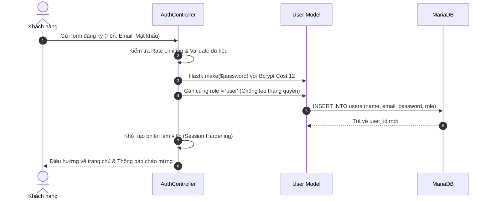

### Luồng 2: Khám Phá Sản Phẩm, Bộ Lọc & Tìm Kiếm Thời Gian Thực

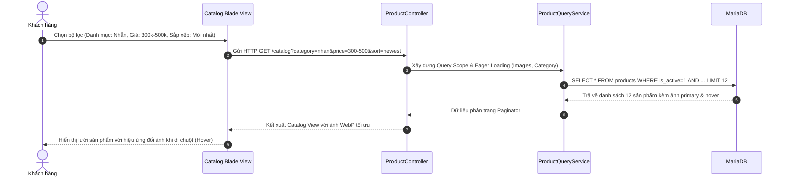

### Luồng 3: Giỏ Hàng Trượt & Trải Nghiệm Quà Tặng Cao Cấp

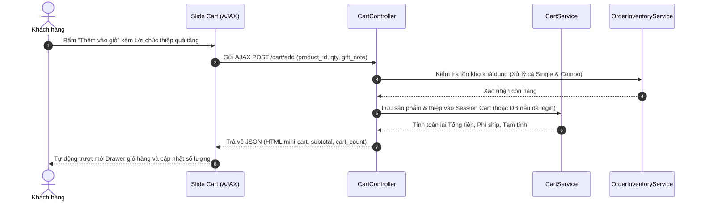

### Luồng 4: Đặt Hàng & Thanh Toán VNPay / COD

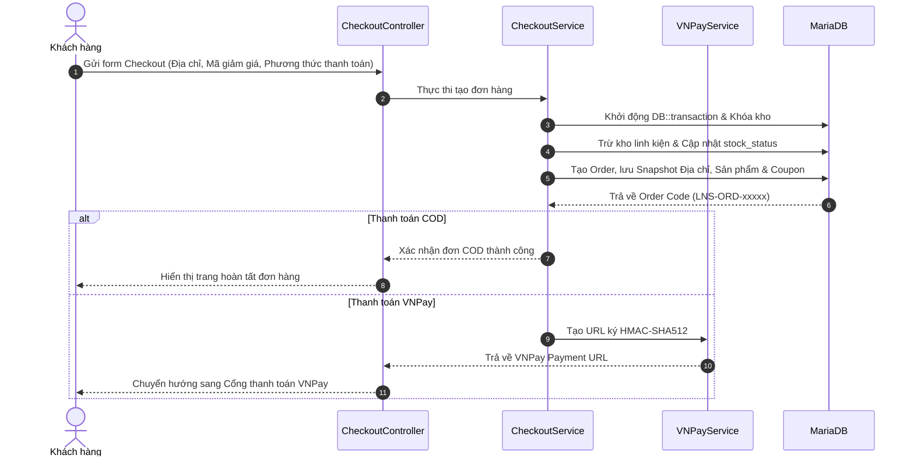

### Luồng 5: Vòng Đời Đơn Hàng, Hủy Đơn & Hoàn Tiền Trực Tuyến

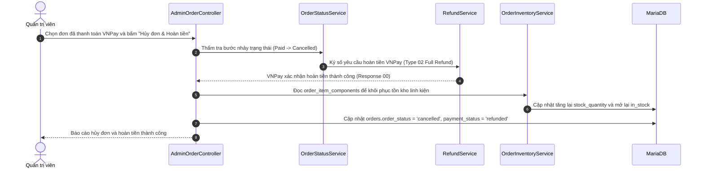

### Luồng 6: Quản Lý Tồn Kho Sản Phẩm Đơn & Bộ Sản Phẩm (Bundle/Gift)

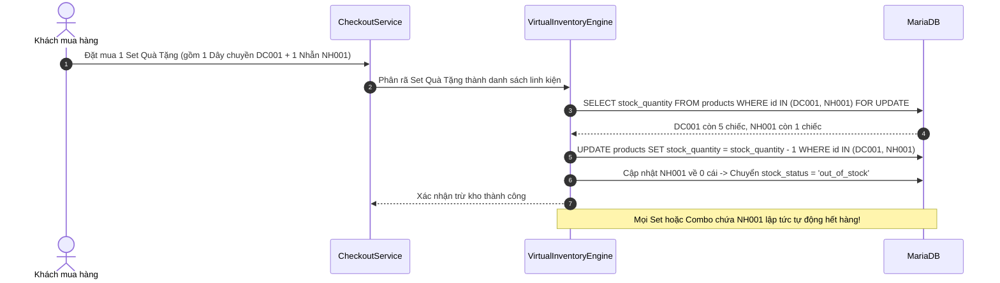

### Luồng 7: Động Cơ Khuyến Mãi & Phiếu Giảm Giá Đa Điều Kiện

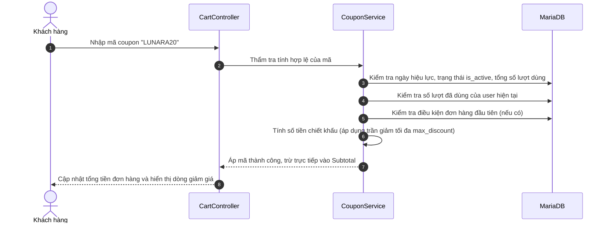

### Luồng 8: Đánh Giá Có Xác Thực Mua Hàng & Kiểm Duyệt Đánh Giá

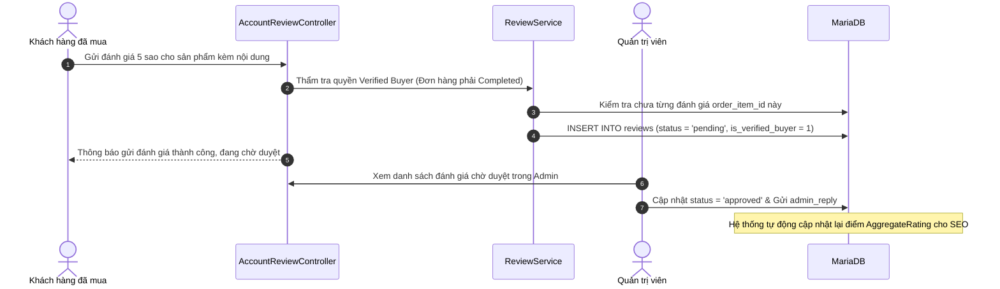

### Luồng 9: Chăm Sóc Khách Hàng Concierge & Live Chat Trực Tuyến

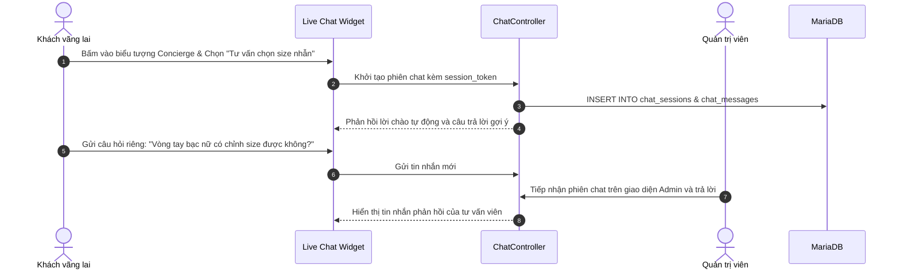

### Luồng 10: Trung Tâm Điều Hành Doanh Nghiệp & Phân Tích Tài Chính

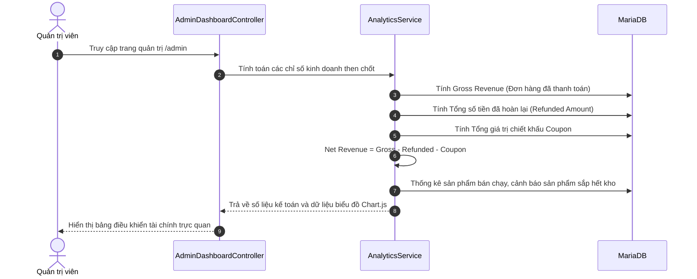

### Luồng 11: Hồ Sơ Khách Hàng 360 & Phân Tích LTV / RFM

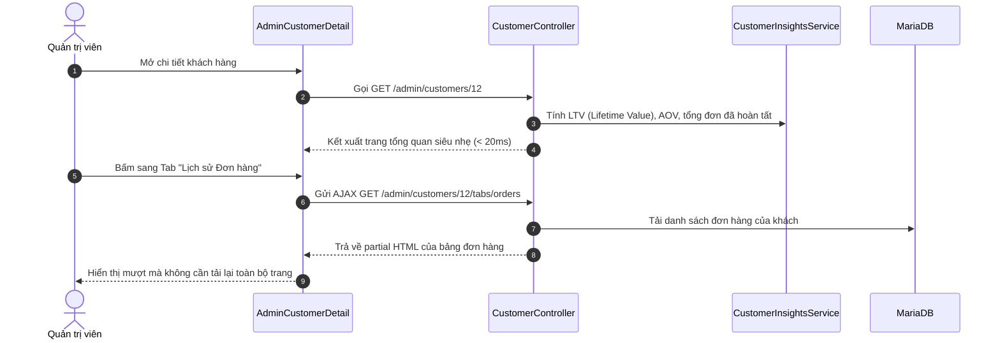

### Luồng 12: Quản Trị Nội Dung Tin Tức & Tự Động Hóa SEO Microdata

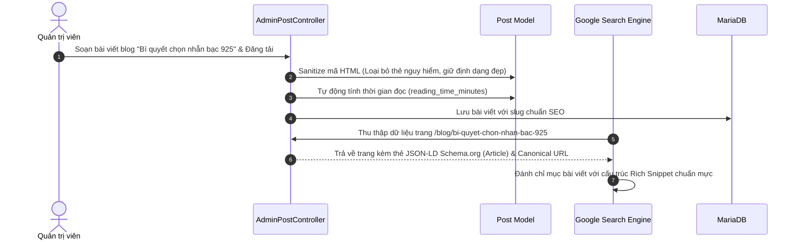

---

## 17. BẢN ĐỒ CẤU TRÚC MÃ NGUỒN & LỚP DỊCH VỤ (DIRECTORY LAYOUT & SERVICE LAYER)

```text
d:\Lunara/
├── app/
│   ├── Http/
│   │   ├── Controllers/
│   │   │   ├── Account/          # Hồ sơ, đơn hàng cá nhân, sổ địa chỉ, đánh giá
│   │   │   ├── Admin/            # Quản trị sản phẩm, combo, ảnh, đơn hàng, khách hàng 360, blog, coupon
│   │   │   ├── Auth/             # Đăng ký, đăng nhập, bảo vệ brute-force
│   │   │   ├── CartController.php      # Giỏ hàng AJAX & mini-cart
│   │   │   ├── CheckoutController.php  # Đặt hàng, snapshot bất biến
│   │   │   ├── HomeController.php      # Trang chủ tối ưu truy vấn O(1)
│   │   │   ├── ProductController.php   # Catalog, bộ lọc, chi tiết sản phẩm
│   │   │   ├── VNPayController.php     # IPN Webhook & Return URL
│   │   │   ├── ChatController.php      # Concierge live chat
│   │   │   └── SitemapController.php   # Dynamic XML Sitemap
│   │   └── Middleware/
│   │       ├── EnsureUserIsAdmin.php   # Chặn truy cập trái phép vào /admin
│   │       ├── SeoRedirectMiddleware.php # Chuyển hướng 301 chống loop
│   │       └── SecurityHeadersMiddleware.php # CSP, HSTS, X-Frame-Options
│   ├── Models/                         # 22 Eloquent Models với các quan hệ chặt chẽ
│   │   ├── Product.php                 # Quản lý sản phẩm, giá bán, quan hệ ảnh và bundle
│   │   ├── Order.php                   # Quản lý đơn hàng, snapshot địa chỉ, quan hệ thanh toán
│   │   ├── OrderItem.php               # Bản chụp sản phẩm trong đơn, quan hệ review
│   │   ├── OrderItemComponent.php      # Bản chụp linh kiện thành phần của combo
│   │   ├── BundleItem.php              # Công thức linh kiện của Bộ sưu tập / Quà tặng
│   │   ├── Coupon.php                  # Quy tắc chiết khấu, hạn mức sử dụng
│   │   ├── Review.php                  # Đánh giá Verified Buyer, che tên riêng tư
│   │   ├── ChatSession.php & ChatMessage.php # Phiên và tin nhắn Concierge
│   │   └── Post.php                    # Bài viết blog, lọc HTML an toàn
│   └── Services/                       # Lớp nghiệp vụ chuyên sâu (Service Layer)
│       ├── CartService.php             # Quản lý giỏ hàng, gộp giỏ, tính tổng tiền
│       ├── CheckoutService.php         # Tạo đơn hàng, khóa kho, snapshot bất biến
│       ├── OrderInventoryService.php   # Trừ kho và khôi phục kho linh kiện combo
│       ├── OrderStatusService.php      # Máy trạng thái đơn hàng (State Machine)
│       ├── CouponService.php           # Thẩm tra mã giảm giá và tính toán chiết khấu
│       ├── ReviewService.php           # Thẩm tra Verified Buyer và duyệt đánh giá
│       ├── CustomerInsightsService.php # Phân tích hồ sơ khách hàng 360, LTV, AOV
│       ├── AnalyticsService.php        # Tính toán doanh thu thuần và báo cáo kinh doanh
│       ├── CloudinaryService.php       # Tải và dọn dẹp tài sản trên Cloudinary CDN
│       └── VNPay/
│           ├── VNPayService.php        # Ký mã HMAC-SHA512 và tạo URL thanh toán
│           ├── RefundService.php       # Xử lý hoàn tiền tự động qua API VNPay
│           └── PaymentReconciliationService.php # Đối soát giao dịch QueryDR
├── database/
│   ├── migrations/                     # 17 tệp Migration chuẩn hóa cấu trúc 20+ bảng
│   ├── seeders/                        # Seeders nạp catalog 45 sản phẩm thực tế và bài viết
│   └── data/catalog.json               # Dữ liệu chuẩn hóa 45 sản phẩm gốc
├── dist/                               # Các gói phân phối nén sẵn phục vụ cài đặt nhanh
├── docs/                               # Bộ tài liệu kỹ thuật tổng thể của dự án
├── public/                             # Tài nguyên tĩnh công khai (CSS/JS compiled, icons, previews)
│   ├── build/                          # Tài nguyên đã biên dịch tối ưu từ Vite (CSS 450 KB, JS 246 KB)
│   └── media-previews/                 # Ảnh WebP thu nhỏ phục vụ fallback siêu tốc
├── resources/                          # Mã nguồn giao diện Blade Templates, CSS và JS gốc
├── routes/                             # Tuyến đường HTTP (web.php, admin.php, auth.php, console.php)
└── tests/                              # Bộ 367 bài kiểm thử tự động (Unit & Feature Tests, 100% Pass)
```

---

<p align="center">
  <strong>LUNARA SILVER — THƯƠNG HIỆU TRANG SỨC BẠC 925 CAO CẤP</strong><br>
  Tài liệu kỹ thuật toàn diện được biên soạn chuẩn mực cho kiểm toán, bảo vệ đồ án và phát triển nâng cấp.
</p>
